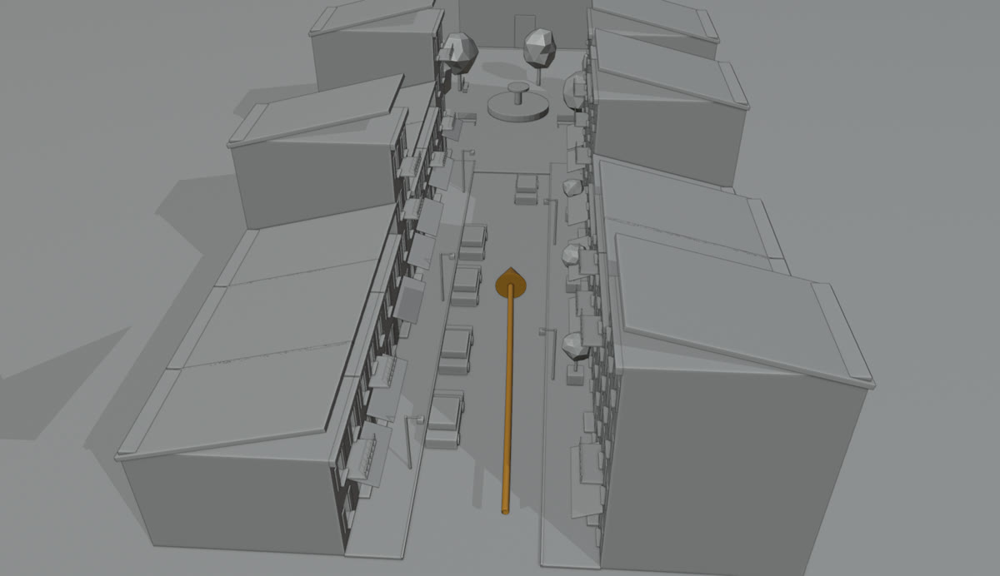
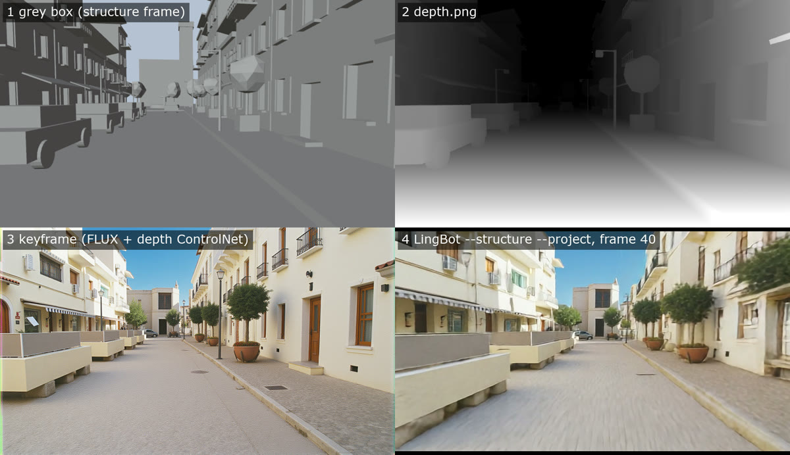
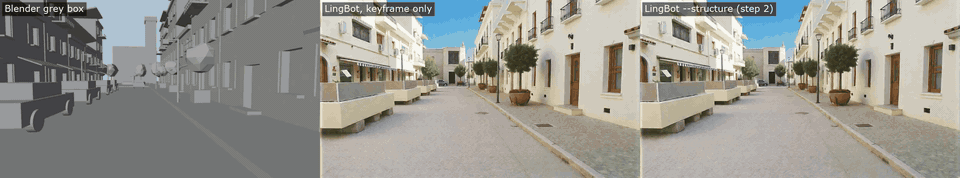

# FastFrames: Video Generation at Interactive Latency

[](https://apple-aiml-research.github.io/ml-fastframes/)
[](https://arxiv.org/abs/2611.23226)
[](https://huggingface.co/apple/FastFrames-S)
[](https://huggingface.co/apple/FastFrames-L)

> **This fork adds Apple Silicon (MPS) support for FastFrames-S text-to-video and the LingBot
> camera-control demo.** On an M4 Max, T2V takes ~45-50 s per 81-frame 480p video with ~18 GB peak
> memory. The LingBot demo makes each 1 s turn in ~12-25 s at 832x464 with a rough preview after
> ~4-6 s, or in ~5-6 s with a preview in under 2 s at `--size 576x320` (lower fidelity). LingBot
> can also turn a [Blender grey box](#from-a-blender-grey-box) into video along its camera path. See
> [Apple Silicon](#apple-silicon-mps) and [MAC.md](MAC.md). Everything else is upstream
> [apple-aiml-research/ml-fastframes](https://github.com/apple-aiml-research/ml-fastframes) and
> still targets Linux + NVIDIA.

This repository contains the official implementation of _FastFrames: Video Generation at
Interactive Latency_. We release [FastFrames-S](https://huggingface.co/apple/FastFrames-S)
(1.3B) and [FastFrames-L](https://huggingface.co/apple/FastFrames-L) (14B). Both are
autoregressive, two-step video diffusion models that generate 480p video at interactive
latency. We also release an optimized version of LingBot 1.3B that is 16x faster than the
official model and allows fluid camera-conditioned control.

- [Latency profiling](#latency-profiling)
- [Interactive demo with LingBot](#interactive-demo-with-lingbot)
- [T2V generation](#t2v-generation)
- [VBench evaluation](#vbench-evaluation)
- [Training](#training)
- [Citation](#citation)

[](docs/assets/fastframes_demo.mp4)

## Installation

Linux x86-64 with an NVIDIA GPU and a CUDA 12.8-compatible driver. From the repository root:

```bash
uv sync
```

Download FastFrames and third-party weights using the [checkpoint guide](docs/installation.md#checkpoints).

### Apple Silicon (MPS)

FastFrames-S T2V inference runs on Apple Silicon Macs through PyTorch MPS. Don't run `uv sync`
on a Mac, because `pyproject.toml` pins the CUDA wheels. Use a separate venv instead (needs
`ffmpeg` with libx264 on `PATH`):

```bash
uv venv .venv --python 3.12
uv pip install -p .venv/bin/python "torch==2.9.1" "torchvision==0.24.1" "transformers>=5.10" \
    safetensors einops ftfy regex pyyaml numpy huggingface_hub
HF=.venv/bin/hf
$HF download apple/FastFrames-S --include 'fastframes-s/*' --local-dir checkpoints
$HF download zhuhz22/Causal-Forcing causal-forcing++/framewise-2step.pt --local-dir checkpoints
$HF download Wan-AI/Wan2.1-T2V-1.3B --exclude 'diffusion_pytorch_model*' --local-dir checkpoints/Wan2.1-T2V-1.3B

.venv/bin/python scripts/generate.py --model ff-s --checkpoint-dir checkpoints \
    --prompt "A corgi surfing a wave at sunset" --seed 0 --output outputs/corgi.mp4
```

| M4 Max, 64 GB             |                                    |
| ------------------------- | ---------------------------------- |
| model load                | ~5 s                               |
| rollout, 21 latent frames | ~45-50 s (~2.2 s per latent frame) |
| peak memory               | ~18 GB                             |

This is batch generation, not interactive latency: the rollout is compute-bound, about 100×
below the B200 numbers above.

The [LingBot interactive demo](#interactive-demo-with-lingbot) also runs on a Mac (single device,
eager): `.venv/bin/python apps/lingbot/demo.py --gpus 1 --lingbot-root upstream/lingbot-world-v2`.
On the M4 Max each 1 s turn (16 frames) takes ~12-25 s at the trained 832x464, so you explore shot
by shot, and the page shows a rough preview of the chunk ~4-6 s in. Add `--size 576x320` for
~5-6 s turns with a preview in under 2 s: close to interactive, with softer frames, because the
model was trained at 832x464. Setup, measurements and the changes are in
[MAC.md](MAC.md#lingbot-camera-control-interactive-demo).

FastFrames-L (14B) runs too: all 81 frames with an 8-bit KV cache (`--kv-bits 8`) in ~6.4 min on
the M4 Max, or clips of up to 41 frames at full precision (`--frames 41`, ~3 min). `--dit-bits 8`
halves the DiT weights (26.6 -> 13.5 GiB) at the same speed. FastFrames-S takes 40 s. Setup and numbers are in [MAC.md](MAC.md#fastframes-l-14b).

The single-device [latency benchmarks](MAC.md#latency-benchmarks) run too: one FastFrames-S step
(4 frames) takes ~3.2 s on the M4 Max (35.4 ms on a B200), and one LingBot chunk ~26 s.

Training, multi-GPU runs, and the baseline latency rows are not ported. [MAC.md](MAC.md) lists every change and why, including the
Metal flash-attention kernel used for attention on MPS.

### From a Blender grey box

Block out a scene in Blender with untextured boxes, animate a camera through it, and LingBot flies
the same path through a photoreal version. `apps/lingbot/blender_stage.py` exports the camera path
as LingBot conditioning, plus a depth map for the first frame and a render of every frame for
steering.



`scripts/greybox_village.py` builds the test scene above. It's a village street opening onto a
plaza, and the camera (orange) walks up the road for 5 s. Then:

1. **Export** (4 s): `blender_stage.py --structure` writes the camera path, `depth.png` and every
   frame of the path as a grey render.
2. **Keyframe** (~4 min): any depth ControlNet turns `depth.png` into a real first frame. These
   examples use FLUX.1-dev with Union Pro 2.0 in Draw Things.
3. **Project** (37 s): export again with `--project keyframe.png`. The structure frames now show
   the keyframe projected onto the scene from the start camera, instead of grey.
4. **Video** (~1.5 min for 77 frames): `generate.py --image keyframe.png` follows the camera path,
   and `--structure` steers every frame with the projected renders, not just the first.

```bash
/Applications/Blender.app/Contents/MacOS/Blender -b --python scripts/greybox_village.py -- village.blend
/Applications/Blender.app/Contents/MacOS/Blender -b village.blend --python apps/lingbot/blender_stage.py -- \
    --out outputs/village --structure --prompt "A sunny Mediterranean village street ..."
# keyframe.png from outputs/village/depth.png with a depth ControlNet (see MAC.md)
/Applications/Blender.app/Contents/MacOS/Blender -b village.blend --python apps/lingbot/blender_stage.py -- \
    --out outputs/village --project keyframe.png --prompt "A sunny Mediterranean village street ..."
.venv/bin/python apps/lingbot/generate.py --model lingbot-1.3b --lingbot-root upstream/lingbot-world-v2 \
    --condition outputs/village/condition.json --image keyframe.png \
    --structure outputs/village/structure --output outputs/village.mp4
```



[](docs/assets/blender_steering.mp4)

Left to right:

- **The grey box.**
- **LingBot from the keyframe only.** Sharp and sunny, but past the first frame it invents the
  street, and it only partly follows the walk.
- **LingBot with `--structure` and `--project`.** It follows the grey box's layout and the walk,
  and keeps the keyframe's look. Steered by plain grey renders, the frames came out washed out.

What to expect:

- **A depth map loses small parts.** In it, a car is just a box and the wheels disappear, so FLUX
  turned the cars into stone planters. `--structure` keeps whatever the keyframe drew.
- **Projection has no occlusion test.** Surfaces hidden in the first frame take the colours of
  whatever covered them, and nearby ground smears as the camera passes over it. The default
  `--structure-step 2` repaints those; step 3 keeps them.
- **Model recesses, not panels.** Flat windows shade exactly like the wall in the grey renders
  and vanish. Cut them in.

[MAC.md](MAC.md#from-a-blender-grey-box) has the details: the full commands, every
`--structure-step` setting with a night street for comparison, the haze measurements, the
shadowless lighting and the sky fill.

#### TODO: speed and memory on Apple Silicon

The cheap wins are taken (LingBot peaks at ~27 GB; a chunk's DiT is ~80% of its time, its attention
and FFN kernels near peak, the glue between them ~12%). What's left, roughly by expected payoff:

- [x] **FastFrames-L at 81 frames.** Done with an int8 KV cache (`--kv-bits 8`).
- [x] **Fewer denoising steps.** LingBot now skips one of its four DiT passes per chunk by default
      (`--steps 0,1,3`): ~12% faster at the same sharpness, 25% faster demo turns at 576x320;
      `--steps 0,1,2,3` runs all four. `0,3` is 32% faster but hazy
      ([MAC.md](MAC.md#fewer-denoising-steps---steps)). The last step has to stay: the decoder and
      refiner were trained on its features.
- [x] **Reuse the image condition.** Until chunk 8, each LingBot chunk spent ~4 s re-encoding the
      black frames of its VAE image condition. Off CUDA, later chunks now reuse the first chunk's
      last latent: 18-23% faster 157-frame videos, no visible change (`--exact-condition` restores
      upstream's encode; [MAC.md](MAC.md#reusing-the-image-condition---exact-condition-to-turn-off)).
- [ ] **A faster attention kernel.** Attention is ~60% of a DiT block. Probably at the ceiling:
      PyTorch 2.15's MPS SDPA, a separate implementation, lands on the same speed as our Metal kernel.
- [x] **A shorter KV window.** Measured, not worth it: 14 of 18 latent frames saves less than
      run-to-run noise, and 10 makes the scene drift.
- [x] **8-bit DiT weights.** Done for FastFrames-S and -L (`--dit-bits 8`,
      [MAC.md](MAC.md#int8-dit-weights---dit-bits-8)). Not worth it for LingBot: its DiT is 1.7B
      parameters (3.2 GiB in bf16), so int8 would save ~1.3 GiB of the ~27 GB peak and change
      every frame. The KV cache, VAE and activations are what fill that peak.
- [ ] **iPad split: `--kv-bits 8`.** Halves the K/V on the USB link; untested beyond A/B noise
      because the iPad's GPU throttles under sustained load, which caps the split at ~1.26x.
- [ ] **Fuse the glue ops** (norms, modulation, residuals) in a DiT block: at most a few percent.
- [x] **`--structure` haze.** Fixed by projecting the keyframe onto the scene (`blender_stage.py
  --project`); [MAC.md](MAC.md#projecting-the-keyframe---project) has the measurements.

## Latency Profiling

```bash
uv run python evaluation/latency/benchmark.py ff-s
uv run python evaluation/latency/benchmark.py ff-l --gpus 8
```

Example component timings for **FastFrames-S, 1 GPU, 480p**, with a full KV cache.

| Component              | Calls | Latency per call |              Total latency |
| ---------------------- | ----: | ---------------: | -------------------------: |
| DiT evaluation, t=1000 |     1 |          16.1 ms |                    16.1 ms |
| DiT evaluation, t=833  |     1 |          16.2 ms |                    16.2 ms |
| KV refinement          |     1 |           2.2 ms |                     2.2 ms |
| Pixel decoder          |     1 |           0.9 ms |                     0.9 ms |
| **Total**              |       |                  | **35.4 ms** (paper: 36 ms) |

See the [profiling guide](docs/inference.md#profiling) for details and baselines.

## Interactive Demo with LingBot

Complete the [demo setup](docs/lingbot.md#interactive-demo-13b), then launch one of:

```bash
CUDA_VISIBLE_DEVICES=0 uv run --extra lingbot --extra demo python apps/lingbot/demo.py --gpus 1
CUDA_VISIBLE_DEVICES=0,1,2,3,4,5,6,7 uv run --extra lingbot --extra demo python apps/lingbot/demo.py --gpus 8
```

and open `http://localhost:8000`.

## T2V Generation

```bash
uv run python scripts/generate.py --model ff-s --checkpoint-dir checkpoints \
    --prompt "A corgi surfing a wave at sunset" --seed 0 --output outputs/corgi.mp4
```

Outputs 832 × 480 video, 81 frames at 16 fps. Use `--model ff-l` for FastFrames-L.

To generate the videos on our project page (20+ videos):

```bash
uv run python scripts/generate_project_page.py --model ff-s --output-dir outputs/project_page/ff-s
uv run python scripts/generate_project_page.py --model ff-l --output-dir outputs/project_page/ff-l
```

See the [generation guide](docs/inference.md#generation) for details.

## VBench Evaluation

Follow the [evaluation guide](docs/inference.md#evaluation) to reproduce Table 1's
Quality / Semantic / Total scores.

## Training

### [Causal Forcing++ -> FastFrames-S](docs/training.md#causal-forcing---fastframes-s)

FastFrames-S keeps the two-step frame-wise Causal Forcing++ generator frozen and trains the
networks around it.

### [Wan2.1-14B -> FastFrames-L](docs/training.md#wan21-14b---fastframes-l)

We first distill Wan2.1-14B into a two-step causal model following the Causal Forcing++ recipe,
then train its pixel decoder and KV refinement network as for FastFrames-S. We release all
checkpoints: 1) a causal teacher trained on latents generated by Wan2.1-14B; 2) the
consistency-distilled model; 3) the DMD-distilled model; 4) the final generator, pixel decoder
and KV refinement network.

## Citation

If you find this work useful in your research, please cite:

```bibtex
@article{chou2026fastframes,
  title   = {FastFrames: Video Generation at Interactive Latency},
  author  = {Chou, Gene and Yang, Guandao and Luan, Fujun and Mescheder, Lars and
             Dong, Wei and Richter, Stephan R. and Koltun, Vladlen},
  journal = {arXiv preprint arXiv:2611.23226},
  year    = {2026}
}
```

## License and Acknowledgments

LingBot-World v2 code and weights follow their upstream [CC BY-NC-SA 4.0 license](LICENSE_LINGBOT).
All other FastFrames code is licensed under the [Apple Sample Code License](LICENSE).
Also see [ACKNOWLEDGEMENTS](ACKNOWLEDGEMENTS) for third-party code.

We thank the authors of [Wan2.1](https://github.com/Wan-Video/Wan2.1),
[Self-Forcing](https://github.com/guandeh17/Self-Forcing), and
[Causal Forcing++](https://github.com/thu-ml/Causal-Forcing) for releasing their code, on which the
FastFrames code and models build.
